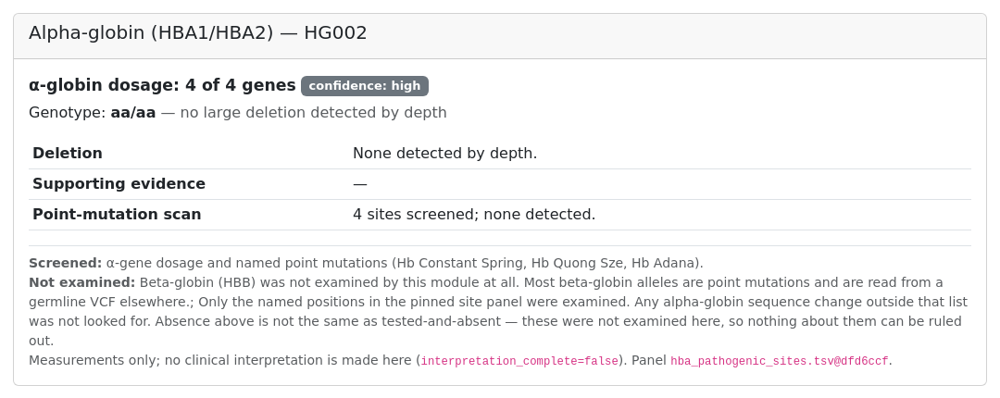
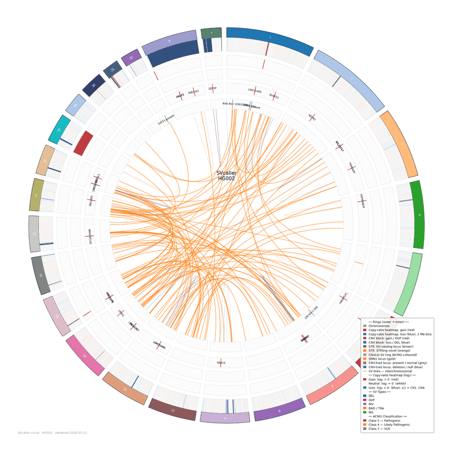

# SVcaller

SVcaller is a Nextflow DSL2 pipeline for human whole-genome sequencing (WGS) on GRCh38. From a FASTQ pair
or a bwa-aligned BAM it calls structural variants (SVs), copy-number variants (CNVs), short tandem repeat
(STR) expansions, SMN1/SMN2 copy number, alpha-globin (HBA1/HBA2) gene dosage and five read-depth
copy-number traits (RHD, AMY1, GSTM1, GSTT1, LPA KIV-2). It writes one HTML report, an Excel workbook and
a set of small per-sample TSV files that other tools can read. It targets about 30x short-read data.

> **Research and educational use only.** SVcaller is not a medical device and has not been clinically
> validated. Its outputs are measurements for review by a qualified person. They are not diagnoses.

[](https://www.nextflow.io/)
[](https://www.docker.com/)
[](#reference-data)
[](#svcaller)

## What it does and does not do

| Does | Does not |
|---|---|
| Calls SVs with Manta + Delly by default, merged by Jasmine; GRIDSS, Scramble and MELT are opt-in | Call SNVs or small indels |
| Re-clusters translocations across callers after the merge (`TRA_CONSENSUS`) | Use SvABA: it is skipped by default and its VCF is never merged |
| Calls CNVs with CNVpytor and GATK gCNV, then merges them by reciprocal overlap | Run on whole-exome data (see [docs/wes-limitations.md](docs/wes-limitations.md)) |
| Genotypes 32 STR loci with ExpansionHunter, plus genome-wide STRling | Size STR alleles longer than the read length; they are reported as a lower bound |
| SMN1/SMN2 copy number (SMNCopyNumberCaller), with an explicit no-call below 18x | Support any build other than GRCh38 with `chr`-prefixed names |
| Measures alpha-globin dosage from depth, junction reads and a fixed site panel | Name a single alpha deletion allele when depth cannot tell two apart; it reports the group (for example `--SEA\|--MED`) |
| Checks every DEL/DUP of at least 1 kb against read depth (annotation only) | Remove a caller-supported call because depth disagrees |
| Annotates SVs with AnnotSV, a GIAB SV panel of normals and gnomAD-SV frequency | Run AnnotSV without its 6.9 GB database (a header-only table is written instead) |

## Pipeline



*Figure 1. Data flow. M1 aligns FASTQ input (BAM input skips alignment and runs `FILTER_CHROMS`). The
callers run on the validated BAM, except M8 alpha-globin, which reads the raw BAM because its depth
baselines were calibrated on it. M3b traits use the CNV consensus as corroboration. Source:
[docs/img/pipeline.mmd](docs/img/pipeline.mmd).*

## Where it sits in the OmniGen suite

| Repository | Role |
|---|---|
| OmniGen (private) | Grades and renders reports from the outputs below; never calls variants |
| [pgx-suite](https://github.com/alvin8-git/pgx-suite) | Medicine response, HLA, blood group |
| **SVcaller** (this repo) | SVs, CNVs, SMN1/SMN2, alpha-globin, STR expansions, depth traits |
| [poly-suite](https://github.com/alvin8-git/poly-suite) | Polygenic scores, ancestry |

OmniGen reads SVcaller's per-sample output folder, for example `provenance.json`,
`<sample>.trait_depth.regions.bed.gz` and the caller columns of `filtered.tsv`.

## Requirements

| Item | Version or size | Checked here |
|---|---|---|
| OS | Linux x86_64 | Ubuntu, kernel 5.15 |
| Nextflow | `>=25.10.0` (`manifest.nextflowVersion`) | 25.10.4 |
| Java | 17 or later (for Nextflow) | not checked separately |
| Docker | any recent release | 28.3.2 |
| Python + pytest | only for the unit tests | Python 3.13.2 |
| CPU / RAM | one 30x HG002 BAM ran in 77 min with `--max_cpus 48 --max_memory 100.GB` ([docs/CHANGES.md](docs/CHANGES.md), 2026-11-11) | from repo records |
| Disk | about 120 GB for the filtered copy of a 30x BAM, plus the input BAM and intermediates; plan for at least 500 GB of scratch | estimate, not measured end to end |

All tools run in pinned containers. Three images are not public and must be built locally (next section).

## Installation

```bash
git clone https://github.com/alvin8-git/SVcaller.git
cd SVcaller

# Local images (not on any registry)
docker build -f Dockerfile.utils -t svcaller/utils:1.3 .
docker build -f Dockerfile.smncopynum -t svcaller/smncopynum:1.2 modules/smn_caller/patches

# Only if you will use --run_melt: needs MELTv2.2.2.tar.gz in the repo root
# (free registration at melt.igs.umaryland.edu)
docker build -f Dockerfile.melt -t svcaller/melt:2.2.2 .
```

The two `docker build` lines are taken from `Dockerfile.smncopynum` and `docs/CHANGES.md`; they were
not re-run in this session (both images were already present). Public biocontainers are pulled by
Nextflow on first use. `tests/test_local_images.py` fails with the build command if a pinned
`svcaller/*` image is missing.

## Reference data

**Link not yet published.** The suite's shared reference bundle will be hosted here:

```text
https://<REF_BUNDLE_URL>/ref.tar.gz
sha256: <TO_BE_PUBLISHED>
```

The bundle is about 58.5 GB and holds `ref/{GRCh38, annotsv, pgsc, omnigen, mondo.sssom.tsv}`.
SVcaller needs only `ref/GRCh38/` and, optionally, `ref/annotsv/`. The bundle contents are taken from
the suite's deployment notes; the tarball itself was not opened in this session.

| Input | Parameter | Size | Needed |
|---|---|---|---|
| `hg38.canonical.fa` + `.fai` + `.dict` (chr1-22, X, Y, M) | `--ref_fasta` | 3.0 GB | yes |
| bwa-mem2 index next to the FASTA (`.0123`, `.bwt.2bit.64`, `.amb`, `.ann`, `.pac`) | inferred from `--ref_fasta` | about 16 GB | FASTQ input only |
| Autosomal intervals BED | `--intervals` | 4 KB | with `--pon` |
| GATK gCNV panel of normals | `--pon` | 447 MB | for GATK gCNV calls |
| GIAB SV panel of normals BED | `--sv_pon` | 248 KB | optional |
| AnnotSV `Annotations_Human/` | `--annotsv_db` | 6.9 GB | optional |
| GIAB HG002 SV truth (T2TQ100-V1.0, v5.0q) | `--giab_truth`, `--giab_truth_v5q` | 9.3 MB, 46 MB | benchmark only |

The two panels of normals are not in the bundle and are not committed (`pon/` is gitignored).

**Building it yourself:**

- **FASTA.** Use a UCSC-style GRCh38 with `chr` names, keep chr1-22, X, Y and M, then
  `samtools faidx` and `samtools dict`. Index with bwa-mem2 for FASTQ input. The classic BWA index is
  only needed if you re-enable SvABA. Do not use `validation/download_refs.sh` as it stands: it
  downloads the Ensembl primary assembly, which has no `chr` prefix, and writes to a fixed
  developer path.
- **gCNV panel of normals.** `workflows/pon_build.nf` from GIAB HG001-HG007 BAMs
  ([docs/howto-build-pon.md](docs/howto-build-pon.md)).
- **SV panel of normals.** `workflows/sv_pon_build.nf` (Manta per GIAB sample, HG002 excluded,
  SURVIVOR merge, sites seen in at least 2 samples).
- **AnnotSV.** `INSTALL_annotations.sh` from AnnotSV 3.4.6. Pass the `Annotations_Human` folder.
- **GIAB truth.** NIST GIAB FTP, `ReferenceSamples/giab/release/AshkenazimTrio/HG002_NA24385_son/`
  (URLs as used in `validation/download_refs.sh`).

## Quick start: smoke test

```bash
bash tests/smoke/run.sh            # writes to ./work_smoke (gitignored)
```

The smoke test runs the pipeline's own `ALPHA_GLOBIN` (M8) and `CNV_TRAITS` (M3b) subworkflows on a
12 MB slice of GIAB HG002 committed in `tests/fixtures/smoke/`. The slice covers chr16:1-250000, the
five trait loci and the eight control windows. It then checks nine values against the calls made on
the full 30x HG002 BAM. It needs Docker and the `svcaller/utils:1.3` image. Measured run time: 27 s.
Expected output:

```text
ok    HG002.rh_status.tsv col2 = 2
ok    HG002.rh_status.tsv col3 = pos
ok    HG002.gst_null.tsv col2 = present
ok    HG002.gst_null.tsv col3 = present
ok    HG002.amy1.tsv col2 = 2
ok    HG002.lpa_kiv2.tsv col2 = 5
ok    HG002.alpha_globin.tsv col2 = 4
ok    HG002.alpha_globin.tsv col8 = aa/aa
ok    HG002.alpha_globin.tsv col4 = none
SMOKE TEST PASSED (outputs in .../results/HG002)
```

**Not covered:** alignment, `FILTER_CHROMS`, SV, CNV, STR and SMN calling, annotation and the HTML
report. They need a whole genome. Unit tests: `pytest tests/` (475 passed in 12 s here; a few skip
without `samtools` on `PATH`).

## Usage

### Samplesheet

CSV with header `sample,fastq_1,fastq_2,bam`. Give a FASTQ pair or a BAM on each row, not both.

```csv
sample,fastq_1,fastq_2,bam
HG002,/path/HG002_R1.fastq.gz,/path/HG002_R2.fastq.gz,
HG003,,,/path/HG003.bam
```

### Entry points

| Entry point | Purpose |
|---|---|
| `main.nf` | The pipeline. `--input` and `--ref_fasta` are required. There is no `--help`: without `--input` it stops with `ERROR: --input is required` |
| `workflows/pon_build.nf` | Build the gCNV panel of normals (`--input`, `--ref_fasta`, `--intervals`, `--outdir`) |
| `workflows/sv_pon_build.nf` | Build the SV panel of normals (`--input`, `--ref_fasta`, `--outdir`, `--min_sv_callers`) |
| `tests/smoke/run.sh [dir]` | Smoke test (above) |
| `validation/giab_benchmark.sh <sample> <vcf> [truth_dir]` | Standalone Truvari run against GIAB truth |
| `bin/nf-status.sh <pidfile> <workdir> [baseline] [log]` | Status of a running pipeline from a recorded PID |
| `bin/nf-cleanup.sh <sample>` / `--reclaim [--force]` | Remove a finished sample's work dir / reclaim superseded runs (dry-run by default) |
| `bin/depth_check.py <filtered.tsv> <bam> <out.tsv>` | Add the depth columns to an existing table |
| `bin/compare_results.py <A> <B> <sample>` | Diff the final outputs of two runs (exit 1 on any difference) |

### Main options

| Option | Default | Meaning |
|---|---|---|
| `--input` | required | Samplesheet |
| `--ref_fasta` | required | GRCh38 FASTA; use `hg38.canonical.fa` for BAM input |
| `--outdir` | `results` | One sub-folder per sample |
| `--tmp_dir` | `$TMPDIR` or `/tmp` | Host scratch mounted into containers; point it at a large disk |
| `--pon`, `--intervals` | none | GATK gCNV panel of normals and intervals |
| `--sv_pon` | none | GIAB SV panel of normals BED |
| `--annotsv_db` | none | `Annotations_Human` folder |
| `--eh_catalog` | `assets/eh_catalog.json` | ExpansionHunter catalog (32 loci) |
| `--giab_truth`, `--giab_truth_v5q` | none | Enables Truvari benchmarking |
| `--min_depth` | `25` | Mean depth gate; the run stops below it |
| `--smn_min_depth` | `18` | Below this, SMN is `NoCall:BelowValidatedDepth` |
| `--delly_inv_max_time` | `2h` | Wall-clock cap on `delly call -t INV` only. A duration (`2h`, `90m`, `7200s`) or bare seconds (`7200`); `0`/`false` disables; under 1 s is an error. At the cap the sample continues without delly inversion calls and `<sample>.sv_not_assessed.tsv` has a row |
| `--run_gridss`, `--run_scramble`, `--run_melt` | `false` | Opt-in callers (legacy `--skip_*` flags still work) |
| `--tiered_gridss` | `false` | GRIDSS only on Manta non-PASS regions |
| `--skip_svaba` | `true` | Leave true: SvABA output is not merged |
| `--skip_strling`, `--skip_alpha_globin` | `false` | Skip STRling / M8 |
| `--tra_window` | `1000` | Breakend window (bp) for translocation consensus |
| `--melt_min_reads` | `3` | MELT `-sr` |
| `--auto_cleanup` | `false` | Delete the work dir on success (drops `-resume`) |
| `--max_cpus`, `--max_memory`, `--max_time` | `64`, `120.GB`, `240.h` | Per-process caps |
| `--utils_container` | `svcaller/utils:1.3` | Image for the Python scripts |

All flags are listed in [docs/reference-parameters.md](docs/reference-parameters.md).

### Worked example: GIAB HG002 from a BAM (not run in this session)

```bash
export REF=/path/to/ref PROJ="$(pwd)" TMP=/path/to/scratch
printf 'sample,fastq_1,fastq_2,bam\nHG002,,,/path/to/HG002.bam\n' > HG002.csv

NXF_ANSI_LOG=false nohup nextflow run main.nf -profile docker \
  --input HG002.csv \
  --ref_fasta ${REF}/GRCh38/hg38.canonical.fa \
  --intervals ${REF}/GRCh38/wgs_autosomal.bed \
  --pon ${PROJ}/pon/pon/giab_cnv_pon.hdf5 \
  --sv_pon ${PROJ}/pon/sv_pon/giab_sv_pon.bed \
  --annotsv_db ${REF}/annotsv/Annotations_Human \
  --giab_truth ${REF}/GIAB/GRCh38_HG002-T2TQ100-V1.0_stvar.vcf.gz \
  --tmp_dir ${TMP} \
  --outdir ${PROJ}/results_HG002 -work-dir ${PROJ}/work_HG002 \
  > ${TMP}/HG002_run1.log 2>&1 &
echo $! > ${TMP}/HG002.pid
```

Use `NXF_ANSI_LOG=false` for every background run, use one `-work-dir` per sample, and add `-resume`
to continue a failed run. More: [docs/howto-run-bam-inputs.md](docs/howto-run-bam-inputs.md),
[docs/howto-run-clinical-sample.md](docs/howto-run-clinical-sample.md),
[docs/tutorial-getting-started.md](docs/tutorial-getting-started.md).

## Outputs

```text
<outdir>/<sample>/
├── <sample>.report.html               self-contained HTML report
├── <sample>.variants.xlsx             SV / CNV / STR / SMN sheets
├── <sample>.sv_merged.vcf.gz(.tbi)    merged SV calls (published by TRA_CONSENSUS)
├── <sample>.sv_callers.json           callers that ran, in SUPP_VEC order
├── <sample>.sv_not_assessed.tsv       header only = delly INV finished; a row = delly INV NOT ASSESSED (cap hit)
├── <sample>.filtered.tsv              annotated SVs + caller consensus + DEPTH_* columns
├── <sample>.cnv_consensus.bed         CNVpytor + gCNV consensus
├── <sample>.str.vcf.gz                ExpansionHunter calls
├── <sample>.str_summary.tsv           per-allele sizing class and display value
├── <sample>.sex.json                  inferred sex passed to ExpansionHunter
├── <sample>.smn.tsv                   SMN1/SMN2 copy number (depth-floored)
├── <sample>.smn.raw.tsv               caller's own row, only when the floor applied
├── <sample>.trait_depth.regions.bed.gz  raw depth over trait and control regions
├── <sample>.circos.svg / .png         genome-wide Circos plot
├── provenance.json                    tool versions, images, SVcaller commit
├── bloodgroup/<sample>.rh_status.tsv  RHD copies, Rh(D) status
├── cnv_traits/<sample>.{amy1,gst_null,lpa_kiv2}.tsv
├── alpha_globin/<sample>.alpha_{globin,depth,junction,sites}.tsv
├── qc/                                flagstat, mosdepth summary, insert size
└── <sample>.truvari/                  only with --giab_truth
```

Column definitions, the `SUPP_VEC` order rule, the STR sizing rule and the depth-check bands are in
[docs/reference-outputs.md](docs/reference-outputs.md). How to read the report:
[docs/howto-interpret-report.md](docs/howto-interpret-report.md).



*Figure 2. Alpha-globin card for GIAB HG002, rendered by `bin/hba_report.py` from the smoke-test
output: 4 of 4 genes, `aa/aa`, no panel site variant, and an explicit list of what was not examined.*



*Figure 3. Circos plot for GIAB HG002 (`bin/circos_plot.py`, rendered 2026-07-12, before the
Manta + Delly default). Rings from outside: chromosomes, copy-ratio heatmap, CNV blocks, STR loci,
SV ring, SMN1 and trait loci; arcs are interchromosomal SV links.*

Full example reports for public samples: [docs/demo/HG002_report.html](docs/demo/HG002_report.html),
[docs/demo/HG001_report.html](docs/demo/HG001_report.html),
[docs/demo/COLO829_report.html](docs/demo/COLO829_report.html). They were generated in July 2026 and
predate the alpha-globin card, the depth check and the Manta + Delly default. Their headings use
clinical wording that this README does not endorse.

## Validation

| What | Truth | Result | Source |
|---|---|---|---|
| SVs, HG002 | GIAB T2TQ100-V1.0 | precision 0.733, recall 0.255, F1 0.378 | `docs/demo/HG002_report.html` (2026-07-13) |
| SVs, HG002 | GIAB v5.0q | precision 0.738, recall 0.259, F1 0.383 | same |
| Translocations, COLO829 | 26 published BND events | 24 of 26 recalled after `TRA_CONSENSUS` (0 of 26 before) | `CLAUDE.md` |
| STRs, HG002, 32 loci | T2T-Q100 / v5.0q assemblies | both alleles within 1 repeat at 11 / 15 loci | [docs/howto-validate-eh-vs-q100.md](docs/howto-validate-eh-vs-q100.md) |
| SMN1/SMN2 depth floor | HG002 downsampling | correct 2/2 from 17.9x up; wrong 3/1 at 14.7x | `docs/CHANGES.md` 2026-11-13 |
| Traits, HG001 / HG002 | GIAB v5.0q at GSTM1 | HG002 agrees; HG001 reads 1 copy, not the often-quoted null | [docs/omnigen-additions-plan.md](docs/omnigen-additions-plan.md) |
| Alpha-globin baselines | GIAB HG002-HG007, n = 6 | per-segment intact baselines (HBA2 0.750, HBA1 0.964) | `assets/hba_segments.bed`, `validation/giab_alpha_baseline.tsv` |

The SV numbers come from a run made before two caller fixes. The repository describes the caller set
behind them in two ways (Manta + Delly in the old README, five callers in the report footer). No
benchmark of the current Manta + Delly default has been recorded. Recall is about 25% because short
reads miss most insertions in the assembly-based truth sets.

Known limits: SMN calls need at least 18x mean depth, and that floor comes from one sample. The run
stops below `--min_depth` (25x). AMY1 and LPA KIV-2 copy numbers are proportional and not calibrated.
`INTER_Z_A` in the alpha-globin locus is never scored. On HG001, read depth refutes 96% of large
DEL/DUP calls (`docs/CHANGES.md`, 2026-11-07).

## Troubleshooting

Each entry below is a failure recorded in `docs/CHANGES.md` or `CLAUDE.md`.

| Symptom | Cause and fix |
|---|---|
| Background run hangs with no task lines | Nextflow's ANSI log deadlocks without a TTY. Set `NXF_ANSI_LOG=false` |
| `pull access denied for svcaller/utils` (exit 125) | Local image missing. Build it (see [Installation](#installation)) |
| Manta fails hours in on a BAM input | Reference has contigs the BAM lacks. Use `hg38.canonical.fa`; `VALIDATE_REF_BAM` now fails fast on this |
| Run stops at MOSDEPTH, coverage below threshold | Mean depth under `--min_depth` |
| `MELT_CALL` fails | MELT image not built. Build it or leave `--run_melt` off |
| Tool writes fill the root disk | `--tmp_dir` defaults to `/tmp`. Point it at a large disk |
| `FILTER_CHROMS` is slow | Expected for BAM input. It is cached per sample and reference in `${outdir}/.cache/` |

A failed caller never publishes an empty output file. The run stops instead. See
[docs/explanation-design.md](docs/explanation-design.md).

## Licence

No `LICENSE` file is present. Until the owner adds one, no licence is granted. The previous README
said MIT, but no licence file backed it.

Third-party tools run from their own containers under their own licences, including Manta, Delly,
GRIDSS, Scramble, Jasmine, CNVpytor, GATK, ExpansionHunter, STRling, SMNCopyNumberCaller, AnnotSV,
Truvari, samtools, mosdepth, Picard and bwa-mem2. MELT is free for academic use after registration
and is not redistributed here. Check each tool's licence before use.

## Citation

There is no `CITATION.cff` yet. Please cite the tools above as relevant to your analysis.

## Changes and documentation

Behaviour changes and the incidents behind them: [docs/CHANGES.md](docs/CHANGES.md). Design:
[docs/explanation-design.md](docs/explanation-design.md). Module reference:
[docs/reference-architecture.md](docs/reference-architecture.md). Contributing:
[CONTRIBUTING.md](CONTRIBUTING.md).
